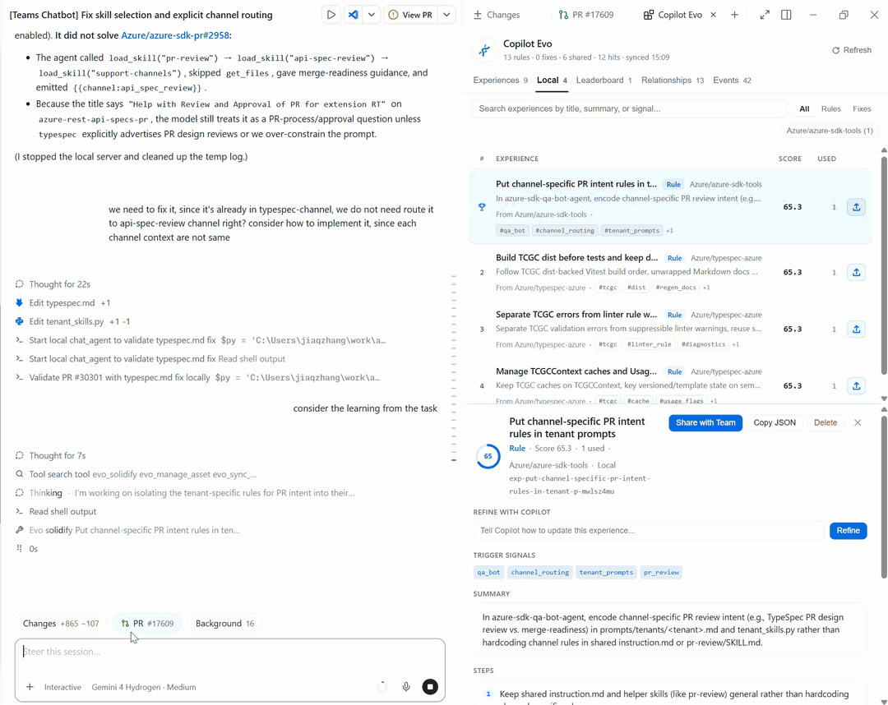
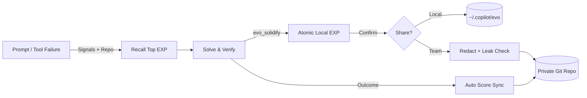
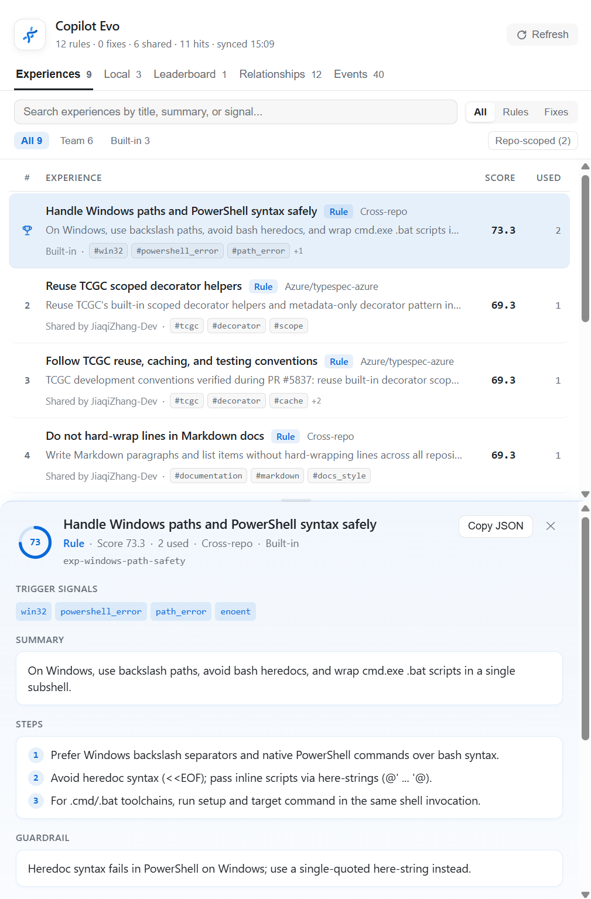
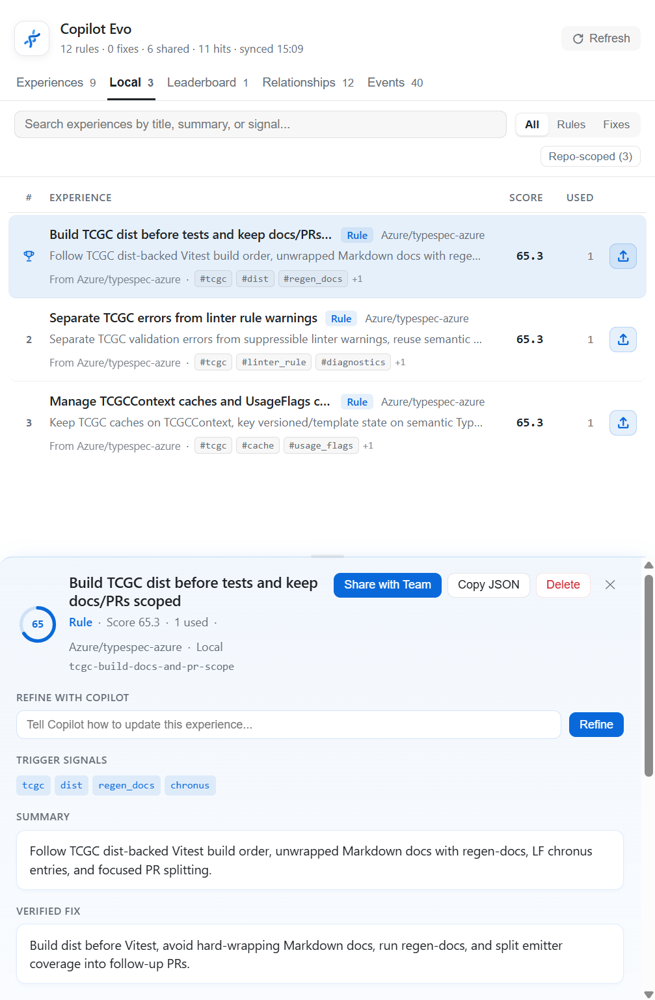
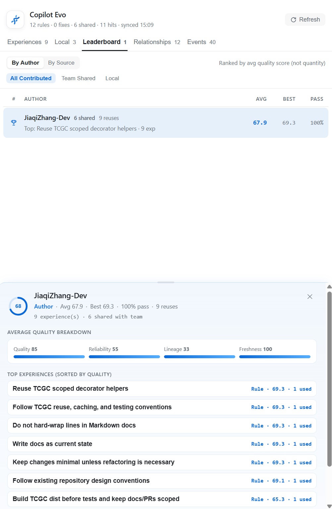
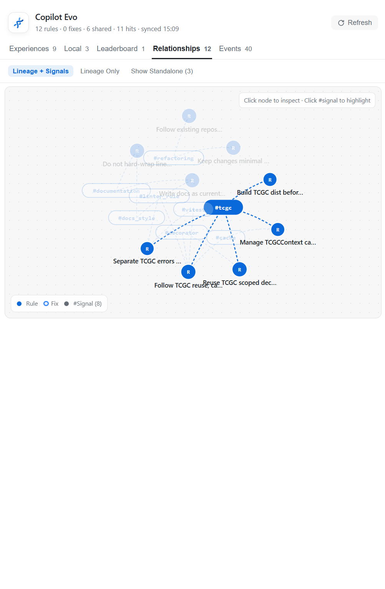
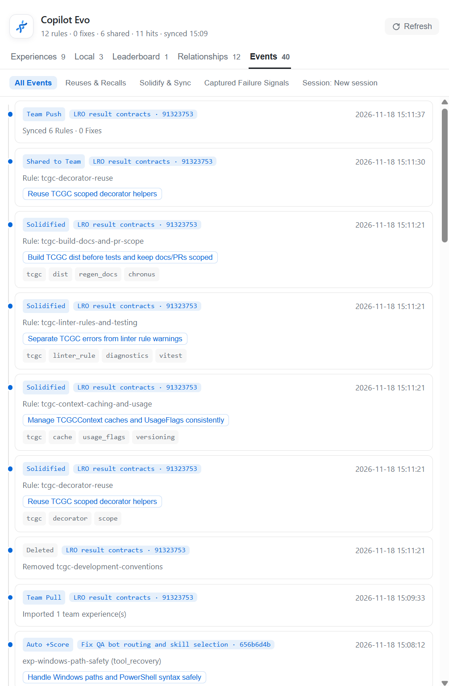
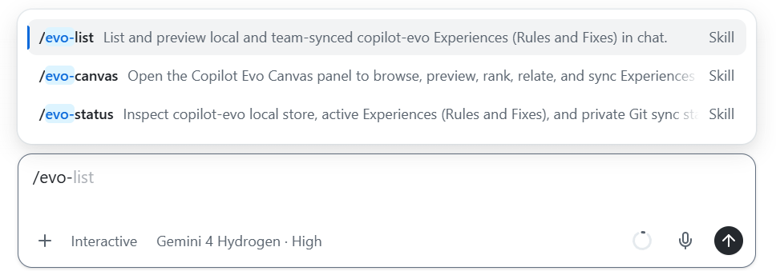

<div align="center">

<p></p>

<h3>Solve once. Evolve everywhere.</h3>
<p>Self-evolving Experience Engine (<code>EXP</code>: Rules &amp; Fixes) for GitHub Copilot App &amp; CLI</p>

<p>
  
  
  
  
</p>

<p>
  <a href="#highlights">Highlights</a> ·
  <a href="#how-it-works">How It Works</a> ·
  <a href="#canvas">Canvas</a> ·
  <a href="#install">Install</a> ·
  <a href="docs/architecture.md">Architecture</a> ·
  <a href="docs/privacy-and-sync.md">Privacy &amp; Sync</a>
</p>

</div>

---

<p align="center">
  
</p>

## Highlights

<table>
  <tr>
    <td width="50%" valign="top">
      <strong>🧬 Atomic Self-Evolution</strong><br />
      Turns verified fixes and conventions into focused <code>Rule</code> and <code>Fix</code> entries automatically—one topic per card.
    </td>
    <td width="50%" valign="top">
      <strong>🎯 Repo-Aware Recall</strong><br />
      Surfaces the highest-scoring <code>Cross-repo</code> or <code>owner/repo</code> knowledge right when prompts or errors hit.
    </td>
  </tr>
  <tr>
    <td width="50%" valign="top">
      <strong>🔒 Local-First &amp; Leak-Safe</strong><br />
      Keeps logs and drafts in <code>~/.copilot/evo/</code>; strips secrets and personal paths and asks before sharing.
    </td>
    <td width="50%" valign="top">
      <strong>⚡ Zero-PR Sync &amp; Canvas</strong><br />
      Shares team wisdom through a private Git repo with an interactive side-panel dashboard (<code>/evo-canvas</code>).
    </td>
  </tr>
</table>

## How It Works



1. **Recall**: Matches top `Rule` and `Fix` experiences to your prompt, error signals, and active repo.
2. **Solidify**: Captures each verified fix or convention atomically in English (`scope: "local"`).
3. **Confirm**: Prompts natively to keep local or sanitize and share directly to your team's private repo.
4. **Evolve**: Tracks recalls, recoveries, and validation runs to continuously rank what works best.

## Canvas

Open the side-panel dashboard anytime with `/evo-canvas`:

<table>
  <tr>
    <td align="center" width="50%">
      <strong>Experiences &amp; Inspector</strong><br />
      <sub>Score-ranked <code>Team</code> &amp; <code>Built-in</code> rules, repo filter, and Copilot refine</sub><br /><br />
      
    </td>
    <td align="center" width="50%">
      <strong>Local Workspace</strong><br />
      <sub>Unshared drafts with inline Copilot refine and one-click team share</sub><br /><br />
      
    </td>
  </tr>
  <tr>
    <td align="center" width="50%">
      <strong>Quality-First Leaderboard</strong><br />
      <sub>Ranked by average quality and pass rate—never spam count</sub><br /><br />
      
    </td>
    <td align="center" width="50%">
      <strong>Relationships Graph</strong><br />
      <sub>Force-directed network of rules, fixes, and shared signals</sub><br /><br />
      
    </td>
  </tr>
  <tr>
    <td align="center" colspan="2">
      <strong>Session-Attributed Events</strong><br />
      <sub>Full timeline of recalls, outcomes, and Git syncs per session</sub><br /><br />
      
    </td>
  </tr>
</table>

## Install

```bash
copilot plugin install JiaqiZhang-Dev/copilot-evo
copilot plugin update copilot-evo
```

Teammates need **Read** access on the shared sync repo to pull updates and **Write** access to share experiences or sync scores. Custom repo setup (`COPILOT_EVO_SYNC_REPO`) and offline `.evopack.json` bundles are covered in [Privacy &amp; Sync](docs/privacy-and-sync.md).

## Commands

<p align="center">
  
</p>

| Command | Action |
| --- | --- |
| `/evo-canvas` | Open the **Copilot Evo** side-panel dashboard |
| `/evo-list` | Preview `Team`, `Local`, and `Starter` experiences in chat |
| `/evo-status` | Inspect store counts, recent signals, and sync status |

<details>
<summary><strong>Tools, Environment Variables &amp; Tests</strong></summary>

- **Tools**: `evo_search`, `evo_solidify`, `evo_manage_asset`, `evo_sync_repo`, `evo_status`
- **Env Vars**: `COPILOT_EVO_HOME` (`~/.copilot/evo`), `COPILOT_EVO_SYNC_REPO`, `COPILOT_EVO_AUTHOR`
- **Tests**: `npm test`

</details>

---

<p align="center">
  <a href="docs/architecture.md">Architecture</a> ·
  <a href="docs/privacy-and-sync.md">Privacy &amp; Sync</a> ·
  <a href="CONTRIBUTING.md">Contributing</a> ·
  <a href="LICENSE">MIT License</a>
</p>


