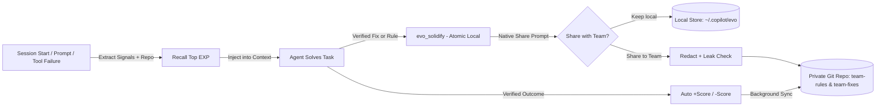

<div align="center">

<p></p>

<h1>Copilot Evo</h1>

<p><strong>Self-evolving Experience Engine (<code>EXP</code>: Rules &amp; Fixes) for GitHub Copilot App &amp; CLI</strong></p>

<p>
  
  
  
  
</p>

<p>
  <a href="#install">Install</a> ·
  <a href="#how-it-works">How It Works</a> ·
  <a href="#copilot-evo-canvas">Canvas UI</a> ·
  <a href="#commands--tools">Commands &amp; Tools</a> ·
  <a href="docs/architecture.md">Architecture</a> ·
  <a href="docs/privacy-and-sync.md">Privacy &amp; Sync</a>
</p>

</div>

---

**Copilot Evo** turns recurring debugging breakthroughs (`Fix`) and cross-project engineering conventions (`Rule`) into atomic, scored, and searchable **Experiences (`EXP`)**. It automatically recalls relevant lessons on every prompt or failure, scores what works from real outcomes, visualizes your team's knowledge network in a side-panel Canvas, and syncs sanitized team knowledge through a private Git repository without PR overhead.

## Highlights

| Capability | Description |
| --- | --- |
| **Atomic Auto-Capture** | Detects failure-to-recovery transitions, `store_memory` saves, and rule cues; solidifies one focused English `Rule` or `Fix` per topic (`2-4` signals, `1-3` steps) locally first. |
| **Repo-Scoped & Cross-Repo Recall** | Automatically binds experiences to `Cross-repo` (`*`) or `owner/repo` via `git remote.origin.url`, boosting exact repository matches during recall. |
| **4-Dimension Quality Scoring** | Ranks experiences automatically (`0-100`) across **Quality (35%)**, **Reliability (30%)**, **Lineage (20%)**, and **Freshness (15%)** from real task recoveries and validation runs. |
| **Explicit Consent & Privacy** | Keeps logs and unshared drafts strictly local under `~/.copilot/evo/`. Native UI confirmation (`Keep local` / `Share to Team`) and multi-stage secret/path leak checks gate every team push. |
| **Zero-PR Private Git Sync** | New sessions auto-pull shared updates in the background; team score deltas merge conflict-free across clones via `pendingSuccessDelta` / `pendingFailureDelta`. |
| **Interactive Canvas Dashboard** | Built-in loopback web UI (`/evo-canvas`) with live cross-session updates, inline **Refine with Copilot**, **Run Validation**, quality-ranked **Leaderboard**, and a force-directed **Relationships** graph. |

## How It Works



1. **Recall**: At session start, on user prompts, and on non-trivial tool failures, `copilot-evo` extracts signals and injects the top matching `Rule` and `Fix` experiences for your active repository.
2. **Solidify Atomically**: Once a fix is verified or a reusable convention is established, Copilot calls `evo_solidify` with `scope: "local"`—keeping each topic atomic instead of bundling unrelated advice into a single entry.
3. **Confirm & Share**: `evo_solidify` prompts you directly to **Keep local** or **Share to Team**. Approved entries are stripped of secrets, internal IPs, and local paths, attributed to your GitHub login, and pushed directly to your private sync repo.
4. **Evolve Automatically**: Subsequent recoveries and whitelisted `Run Validation` checks automatically update reuse counts and quality scores across the team.

## Copilot Evo Canvas

Open the interactive side panel anytime with `/evo-canvas`:

- **`Experiences`**: Score-ranked catalog of `Team` and `Built-in` experiences with `All · Team · Built-in` filters, one-click current-repo toggle, clickable `#signal` tags, `#1` trophy indicator, collapsible Detail Inspector, 4-dimension Score Breakdown, `Run Validation`, and inline **Refine with Copilot**.
- **`Local`**: Dedicated workspace for unshared local rules and fixes featuring a right-aligned Share action with translucent progress overlay and celebration toast.
- **`Leaderboard`**: Quality-first contributor and source board (**By Author** via GitHub CLI login / `git user.name`, or **By Source** repository/chat) ranked strictly by **Avg**, **Best**, and **Pass** rate—rewarding high-signal engineering rather than entry count.
- **`Relationships`**: Force-directed knowledge graph connecting `Rule` nodes, `Fix` nodes, shared `#Signal` clusters, and `ruleId` / `parentId` / `supersedes` lineage with 1-hop neighborhood highlighting and a `Show Standalone` toggle.
- **`Events`**: Real-time audit timeline of captured failure signals, solidifications, auto-scoring outcomes, and Git syncs—tagged with each session's name and short ID for one-click session filtering.

## Install

Install directly as a GitHub Copilot plugin:

```bash
copilot plugin install JiaqiZhang-Dev/copilot-evo
```

Update to the latest version:

```bash
copilot plugin update copilot-evo
```

> **Team Permissions**: Teammates need GitHub **Read** access on the shared sync repository to install and pull updates, and **Write** access to share new experiences or push score deltas. See [Privacy & Sync](docs/privacy-and-sync.md) for custom repository configuration via `COPILOT_EVO_SYNC_REPO` or offline `.evopack.json` bundles.

## Commands & Tools

### Slash Commands

| Command | Action |
| --- | --- |
| `/evo-canvas` | Open the **Copilot Evo** side-panel dashboard |
| `/evo-list` | Print a grouped in-chat preview of `Team`, `Local`, and `Starter` experiences |
| `/evo-status` | Inspect local store counts, recent signals, and Git sync configuration |

### Extension Tools

| Tool | Purpose |
| --- | --- |
| `evo_search` | Search stored `Rule` and `Fix` experiences by query, signals, kind, scope, or repo |
| `evo_solidify` | Save or update one atomic `Rule` or `Fix` with automatic sanitization and share confirmation |
| `evo_manage_asset` | Inspect, promote (`promote_team`), pin/unpin, vote, or delete an experience by ID |
| `evo_sync_repo` | `pull` or `push` team experiences via Git, or `export` / `import` `.evopack.json` bundles |
| `evo_status` | Return store version, counts, session telemetry, and resolved sync repo path |

### Environment Variables

| Variable | Default | Description |
| --- | --- | --- |
| `COPILOT_EVO_HOME` | `~/.copilot/evo` | Override the local store directory for rules, fixes, events, and config |
| `COPILOT_EVO_SYNC_REPO` | `~/.copilot/evo/sync-repo` | Path to an existing local clone of your private team sync repository |
| `COPILOT_EVO_AUTHOR` | GitHub CLI login / `git user.name` | Override the author attribution recorded on newly solidified experiences |

## Documentation & Tests

- [Architecture & Scoring Engine](docs/architecture.md)
- [Privacy, Sanitization & Team Sync](docs/privacy-and-sync.md)
- [Contributing Guide](CONTRIBUTING.md)
- [MIT License](LICENSE)

Run the full test suite:

```bash
npm test
```

