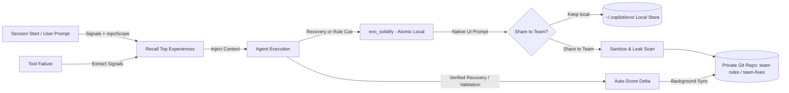

# Architecture

`copilot-evo` is a closed-loop self-evolving Experience engine (`Knowledge`, `Rule`, and `Fix`) built on the `@github/copilot-sdk/extension` runtime and inspired by the [CoALA](https://arxiv.org/abs/2309.02427) agent memory taxonomy (semantic, procedural, and episodic). It captures architecture facts, conventions, and verified fixes automatically, recalls high-scoring matches across sessions, scores outcomes from real execution loops, and visualizes the knowledge base in a loopback Canvas web app.

## Closed-Loop Lifecycle

## Runtime Hooks (`extension.mjs`)

- **`onSessionStart`**: Initializes `~/.copilot/evo/`, triggers a throttled background `maybeAutoPull` from the configured sync repository, detects the active repository slug (`owner/repo`), and injects the active protocol plus matching starter/team/local experiences.
- **`onUserPromptSubmitted`**: Extracts intent signals and strategy cues from each user prompt, recalls top matching experiences filtered by `repoScope` (automatically including repo-scoped rules during PR reviews), and watches for negative feedback cues to support automated downvoting or superseding.
- **`onSubagentStart`**: Injects matching repository and review experiences (or parent-turn active rules) into delegated subagents such as `code-review`, recording subagent recall events.
- **`onPreToolUse`**: Evaluates `guardrail` patterns (such as Windows heredoc safety warnings) against tool arguments before execution.
- **`onPostToolUseFailure`**: Filters trivial editor/file-lookup errors and 10-second duplicate bursts, appends a sanitized `tool_failure` event tagged with session metadata, and recalls relevant `Fix` or `Rule` experiences.
- **`onPostToolUse`**: Detects recovery transitions after failures, tracks cross-turn revisions, emits silent `additionalContext` capture and attribution checks on substantive mutating turns (skipping read-only queries), and bridges `store_memory` saves into `evo_solidify` so durable preferences also enter the Experience store.
- **`onSessionEnd`**: Flushes remaining pending score deltas (`successCount`, `failureCount`, and `recallCount`) on team experiences and appends a `session_summary` event when failures or solidifications occurred.

## Data Model & Scoring (`store.mjs`)

Experiences are organized into three orthogonal categories stored in `knowledge.json`, `rules.json`, and `fixes.json`:

- **`Knowledge`** (`knowledge.json` · Semantic memory): Domain, architecture, service-coupling, or platform behaviors and quirks (how a system works).
- **`Rule`** (`rules.json` · Procedural memory): Actionable conventions, review checklists, guardrails, and step-by-step workflows (what to do).
- **`Fix`** (`fixes.json` · Episodic troubleshooting): Concrete error symptoms, root causes, and verified resolutions (how to fix a failure).

- **Scope (`scope`)**: `starter` (bundled read-only defaults), `local` (machine-local unshared entries), or `team` (sanitized entries shared via Git).
- **Repository Scope (`repoScope`)**: `"*"` (`Cross-repo`) or `"owner/repo"` (normalized from `git remote.origin.url`). Repo-specific experiences receive a relevance boost in matching repositories and are filtered out of unrelated repositories.
- **Provenance**: `sourceProject` (`owner/repo`, `local-git`, or `chat`), `author` (resolved from `COPILOT_EVO_AUTHOR`, local GitHub CLI login in `hosts.yml`, or `git config user.name`), and `updatedAt`.
- **Lineage & Evidence**: `ruleId` (links a `Fix` to the `Rule` it applied), `parentId` (refinement chain), `supersedes` (hides outdated entries from default recall), `references` (sanitized `https://` PR, issue, commit, or docs links proving correctness), and pre-write `findSimilarAssets` similarity detection (warns and returns `similarCandidates` before creating near-duplicate entries without an explicit `id` or `allowDuplicate`).

Each experience is automatically ranked by a composite `0–100` score across four weighted dimensions (`computeGdiBreakdown`):

| Dimension | Weight | Signals Evaluated |
| --- | --- | --- |
| **Quality** | `35%` | Title clarity, summary depth, signal count, actionable steps/solution, and validation commands |
| **Reliability** | `30%` | Logarithmic helpful uses (`successCount` from `upvote`/validation), pass rate (`success / totalRuns`), priority, and failure penalties (separate from `recallCount`) |
| **Lineage** | `20%` | Team promotion, `ruleId` / `parentId` / `supersedes` connections, derived children, and pin status |
| **Freshness** | `15%` | Recency decay based on `updatedAt` |

## Loopback Canvas Server (`canvas-server.mjs`)

The **Copilot Evo** side panel (`evo-dashboard`) is served over an ephemeral loopback HTTP server bound exclusively to `127.0.0.1:0` with:

- Strict `Host`, `Origin`, and `Sec-Fetch-Site` validation on every request.
- Per-process 256-bit `X-Evo-Token` authentication (`timingSafeEqual`) required on all `POST` mutations.
- Strict Content Security Policy (`default-src 'self'; script-src 'self'; style-src 'self'; object-src 'none'`).
- Server-Sent Events (`/api/events`) paired with `fs.watch` on `~/.copilot/evo/` for real-time cross-session updates.
- Direct Copilot chat bridge (`POST /api/assets/refine` → `activeSession.send`) for inline experience refinement.
